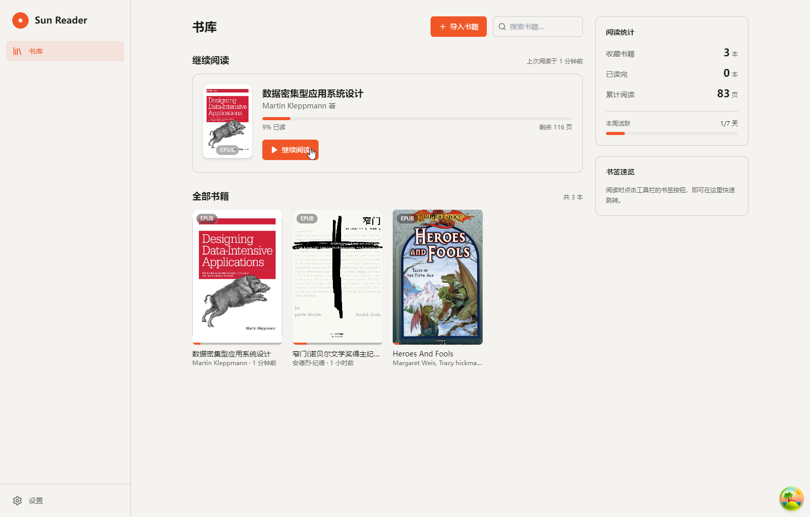

# Sun Reader

一款简洁优雅的桌面端电子书阅读器，基于 Electron + React 构建。



## 功能特性

- **书库管理** —— 导入 EPUB / TXT 书籍，自动提取书名、作者与封面；书库页顶部「继续阅读」卡片直达最近读的书
- **三种阅读模式** —— 标准滚动 / 沉浸翻页 / 双页对开；双页与沉浸模式基于真实分页引擎，窗口缩放自动重排、不出滚动条
- **目录导航** —— 章节标题直接读取书籍自带目录文档（toc.ncx / nav），与原书目录保持一致
- **书签与批注** —— 一键加书签；选中正文即可添加多色批注
- **正文搜索** —— 全文关键词定位，命中处高亮跳转
- **主题与排版** —— 浅色 / 深色 / 羊皮纸三主题，字号行高自由调节
- **进度记忆** —— 阅读位置自动保存，下次打开精准恢复

## 支持格式

| 格式 | 阅读 |
| --- | --- |
| EPUB | ✅ 完整支持 |
| TXT | ✅ 完整支持 |
| PDF / MOBI / AZW3 | 可导入识别，阅读开发中 |

## 快速开始

需要 Node.js 18+ 与 [pnpm](https://pnpm.io)。

```bash
pnpm install        # 安装依赖
pnpm run dev        # 开发模式（热更新 + DevTools）
pnpm test           # 运行单元测试
pnpm run build:win  # 打包 Windows 安装包（另有 build:mac / build:linux）
```

## 项目结构

```
src/
├── main/       # Electron 主进程：窗口、菜单、IPC、EPUB 解析
├── preload/    # 渲染进程安全桥接（contextBridge）
└── renderer/   # React 界面源码（Vite root）
tests/          # 单元测试（Vitest）
docs/           # 文档与截图
```

## 数据存储

书籍与阅读数据统一存放在用户主目录下的隐藏目录 `~/.sunreader/`：

```
~/.sunreader/
├── Books/         # 导入的书籍文件
├── Covers/        # 封面图片缓存
├── library.json   # 书库元数据、进度、书签、批注
└── settings.json  # 窗口大小与位置
```

删除该目录即可完全重置应用数据。

## 许可证

[MIT](./LICENSE)
